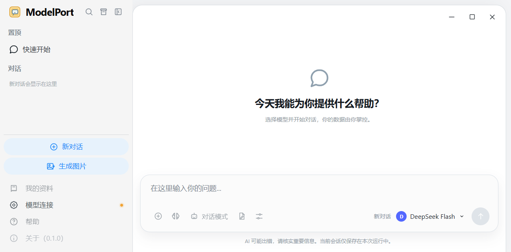

# ModelPort

ModelPort（模型港）是一款本地优先的多模型 AI 桌面客户端。软件本身不提供模型能力，用户可以连接自己的云端 API Key，或使用 Ollama 等本地模型服务。



## 当前进度

当前版本是可本地启动的文本对话版本，已经包含：

- 自动保存的本地会话、会话切换与删除
- 新对话与图像生成入口
- 多模型选择菜单
- 向 OpenAI、DeepSeek 和本机 Ollama 发送真实文本对话
- 逐段显示模型回复，并可在回复过程中停止生成；停止后保留已收到的内容
- 请求失败时保留已发送的用户问题并显示错误；未收到回复时可点“编辑并重试”修改后再发送
- 模型连接测试和可用模型发现
- 可在“默认模型”选择并保存 OpenAI、DeepSeek 或具体 Ollama 模型，用于空白启动和新对话；未设置时使用本机 Ollama，历史会话沿用自己的模型
- Windows 安全凭据库中的云端 API Key 保存与删除
- AI 回复的 Markdown 渲染
- 自定义桌面标题栏、窗口拖动和窗口控制
- 不同窗口尺寸下的响应式布局
- 两栏设置中心：ModelPort账户、模型提供方、默认模型、联网搜索、MCP、知识库、Skills、智能体、文档解析器、对话设置、键盘快捷键和常规设置；后续功能带独立开发入口
- 本地指令型 Skills：新建、单文件导入、从公开 GitHub 仓库预览安装、编辑、启用/禁用、删除，以及会话级技能选择和版本提示
- 本地文本知识库：批量 TXT / Markdown 导入、资料管理、检索预览、聊天选择与来源快照；首版采用关键词检索，不下载额外模型
- 技能与知识库在输入区同排选择，齿轮打开各自管理页；长名称悬停可查看完整名称
- 对话设置：最近完整问答轮数、全局提示词、Markdown / 纯文本和字号；本地保存、恢复默认及未保存退出提醒
- 键盘快捷键：两种发送方式、新对话 / 新话题、循环会话切换、编号跳转与本机会话搜索；发送方式已从对话设置迁入本页，旧配置保持有效
- 常规设置：浅色 / 深色 / 跟随系统、动画、启动会话和侧栏偏好；JSON 聊天备份导出、预览合并导入及确认清空

当前只支持固定的 OpenAI、DeepSeek 官方 API 地址和本机 Ollama（`127.0.0.1:11434`）。Anthropic、图像生成、附件、重新生成和自动重试尚未接入；界面会明确标识尚不可用的入口。会话保存在本机 WebView 数据中，重启后保留；停止或中断的部分回复会保留标记，不作为下一次请求的完整助手回复。聊天内容未加密，API Key 仍单独保存在 Windows 安全凭据库。

如果只通过浏览器打开前端预览，可以查看界面，但真实模型请求必须在 Tauri 桌面窗口中运行。

Skills 首版只支持指令内容，不执行脚本或读取关联资源；云端模型会收到当前选中的技能正文。本地技能库未加密，保存在应用数据目录。使用与开发接口见 [Skills 文档](./docs/SKILLS.md)。

知识库资料未加密，保存在独立应用数据目录。只发送命中片段，每次云端知识库请求前确认；未命中不调用模型。当前仅支持 UTF-8 的 TXT / Markdown，不支持 PDF / Word 或向量语义检索。用法和接口见 [知识库文档](./docs/KNOWLEDGE.md)。

对话设置保存在独立的本机 WebView 配置中。默认携带最近 20 轮完整问答，停止 / 失败的回复不参与历史上下文；数量上限不代表 Token 容量。提示词会随请求发送给选中的模型，用法和生效时机见 [对话设置文档](./docs/CHAT_SETTINGS.md)。

默认 Enter 发送、Shift + Enter 换行、Ctrl + Enter 仅保存而不生成回复。仅保存消息后续可能作为上下文发送；Ctrl + Shift + N 开启新话题，不删除记录但不携带此前聊天。完整组合与开发入口见 [键盘快捷键文档](./docs/KEYBOARD_SHORTCUTS.md)。

常规设置单独保存在本机，默认浅色、恢复上次会话及展开侧栏。外观保存后立即生效，启动偏好用于下次打开软件；备份只包含聊天与历史来源片段，未加密。合并导入不覆盖现有会话，清空不可直接撤销，请先导出；不会删除 API Key、技能或知识库。多语言、开机自启动、托盘和同步尚未开放。用法与数据边界见 [常规设置文档](./docs/GENERAL_SETTINGS.md)。

默认模型保存后应用到当前空白窗口和之后的新对话，不改写历史会话。选择云端模型不等于已配置 API Key；更多可用模型可先在“模型提供方”测试连接获取。不在当前列表中的已保存选择仍保留，不擅自切换服务；用法和存储边界见 [默认模型文档](./docs/DEFAULT_MODELS.md)。

## 技术栈

- Tauri 2
- React 19
- TypeScript
- Vite
- Rust

## 获取源码与开发

在 Windows 上，先按 [Tauri 官方前置要求](https://v2.tauri.app/start/prerequisites/)安装 Node.js、Rust 的 MSVC 工具链、Microsoft C++ Build Tools（含 Windows SDK）及 WebView2。克隆仓库后，在 PowerShell 中运行：

```powershell
git clone <仓库地址> modelport
cd modelport
npm ci
npm run tauri dev
```

`npm ci` 根据已提交的 `package-lock.json` 安装前端依赖；后续依赖未变化时，无需每次启动都重装。仅预览界面可运行 `npm run dev`；检查前端生产构建可运行 `npm run build`。浏览器预览无法发送真实模型请求。

## 构建可双击启动的 Windows 程序

在项目根目录的 PowerShell 中运行：

```powershell
powershell -NoProfile -ExecutionPolicy Bypass -File .\scripts\build-portable.ps1
```

脚本会调用 Tauri 构建，并将程序放到 `release/ModelPort.exe`。之后双击 [启动 ModelPort.cmd](./启动%20ModelPort.cmd) 即可运行，无需开发服务器。`release/` 中的程序和 `src-tauri/target/` 中的编译缓存不属于源码，Git 会忽略它们。运行该程序的 Windows 电脑需要 WebView2 运行时。

若 `release/ModelPort.exe` 已存在且内容不同，脚本会停止，保护旧文件。确认更新时运行：

```powershell
powershell -NoProfile -ExecutionPolicy Bypass -File .\scripts\build-portable.ps1 -ReplaceExisting
```

脚本会先把旧程序移入 `release/archive/`，再放入新程序；若新旧文件相同，则直接结束。

## 桌面回归检查

本机 Ollama 已运行并安装模型时，可用 Node.js 24 和独立 WebView 数据目录检查默认模型、弹窗遮罩、新建对话和历史模型恢复：

```powershell
$env:WEBVIEW2_USER_DATA_FOLDER = Join-Path $env:TEMP ('modelport-check-' + [guid]::NewGuid().ToString('N'))
$env:WEBVIEW2_ADDITIONAL_BROWSER_ARGUMENTS = '--remote-debugging-port=9342 --remote-allow-origins=*'
Start-Process -FilePath "$PWD\release\ModelPort.exe"
Remove-Item Env:WEBVIEW2_USER_DATA_FOLDER, Env:WEBVIEW2_ADDITIONAL_BROWSER_ARGUMENTS
node scripts/verify-desktop.mjs 9342
node scripts/verify-composer-layout.mjs 9342
```

检查脚本只允许空白的测试数据目录，不会在含真实历史记录的窗口中运行。完成后关闭测试窗口，双击正常启动文件即可。

输入区布局检查覆盖默认和最小窗口、两个管理入口的键盘操作，以及长名称与更新标记的同排显示，不修改本地技能或知识库。

## 后续更新

如果你修改过源码，先将改动提交到自己的 Git 分支。拉取新版本后，再安装锁文件指定的依赖并构建：

```powershell
git pull --ff-only
npm ci
powershell -NoProfile -ExecutionPolicy Bypass -File .\scripts\build-portable.ps1 -ReplaceExisting
```

本地聊天记录留在应用的 WebView 数据中，API Key 留在 Windows 安全凭据库；Git 只用于管理源码与构建脚本。当前仓库没有远程地址时，先完成初始提交并设置远程仓库，再使用上面的克隆和拉取流程。

## 设计原则

- 本地优先：会话、配置和凭据尽可能留在用户设备上。
- 自带密钥：用户决定接入哪个服务商，并清楚知道请求发送到哪里。
- 模型中立：同一个对话界面可以切换云端模型和本地模型。
- 安全默认：API Key 进入 Windows 安全凭据库，不写入普通配置文件或聊天记录。

源码模块和 Git 更新流程见 [项目结构文档](./docs/ARCHITECTURE.md)；设置扩展接口见 [设置模块开发文档](./docs/SETTINGS.md)；功能范围与后续计划见 [产品设计文档](./docs/PRODUCT_DESIGN.md)。
